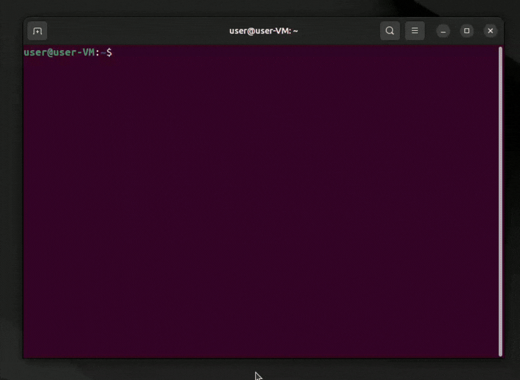

# CVE-2026-61512: VeraCrypt CheckFilesystem Command Injection

VeraCrypt's Linux elevated CoreService accepts a serialized `CheckFilesystemRequest` containing volume information. In the audited code, the supplied `VirtualDevice` value is concatenated into a command string. A terminal execution path that interprets this string as shell syntax allows injected commands to run as root.

| Field | Details |
|---|---|
| CVE | CVE-2026-61512; ID reserved by VulnCheck during coordinated disclosure |
| Platform | Linux |
| Documented reproduction | VeraCrypt 1.26.29 on Ubuntu 24.04 |
| Prerequisites | An active elevated CoreService session, same-UID access to a writable request pipe, and an available terminal execution path that evaluates the command string |
| Impact | Arbitrary command execution with root privileges |
| Reported | July 12, 2026 |
| Researcher | Haitam Lazaar |

## Demonstration



The recorded demonstration uses the sudoers payload included in the PoC. Terminal availability, argument handling, and access to the display affect reproduction.

## Vulnerability

Relevant command-construction excerpt from the [audited source](https://github.com/veracrypt/VeraCrypt/blob/48f8d87418052b5bb05f157063181c6004aa5f09/src/Core/Unix/CoreUnix.cpp):

```cpp
string xargs = fsckPath + " ";
#ifdef TC_LINUX
if (!repair)
    xargs += "-n ";
else
    xargs += "-r ";
#endif
xargs += string(mountedVolume->VirtualDevice) + "; echo '[Done]'; read W";
```

Several terminal argument lists explicitly include `sh -c`. For example:

```cpp
static const char* urxvt_args[] = {"-title", "fsck", "-e", "sh", "-c", NULL};
```

A supplied device value such as `/dev/null; /usr/bin/id` becomes:

```sh
/usr/sbin/fsck -n /dev/null; /usr/bin/id; echo '[Done]'; read W
```

When evaluated by the root service's shell, the semicolon separates a second command from `fsck`. The `xterm` entry does not explicitly include `sh -c`; its behavior must be checked separately rather than assumed equivalent to the other entries.

## Exploitation prerequisites

Exploitation requires an active elevated CoreService session and same-UID access to the VeraCrypt process holding the request pipe. This is not exploitable by an arbitrary local user at any time.

The PoC targets the request pipe of a service elevated by a legitimate mount operation. It runs as the same UID as the VeraCrypt user and reopens a writable pipe descriptor through `/proc/<pid>/fd/<n>`, subject to process dumpability and system access controls. No new sudo invocation or passwordless sudoers rule is required for this live-session variant.

Command execution additionally requires a suitable installed terminal, a usable display connection, and shell interpretation of the constructed command. A terminal that fails to start or handles the arguments differently may prevent the effect.

## Build and run

From this repository's root:

```sh
gcc -O2 -Wall exploit/poc_checkfs_inject.c -o poc_checkfs_inject
./poc_checkfs_inject
```

The GUI must already have an active elevated session, and the service must be able to launch the relevant terminal in that session. The included default payload creates `/etc/sudoers.d/vc_pwned` and grants passwordless sudo access. Use a disposable VM. See [usage and cleanup](exploit/README.md), including the custom-payload behavior.

## Remediation and vendor coordination

During coordination on July 20, 2026, the VeraCrypt maintainer shared a private draft patch designed to eliminate the root cause of the live-session attack. The proposal introduced two complementary defenses:
1. **Restricting `/proc` inspection:** The GUI frontend disables process dumpability (`prctl(PR_SET_DUMPABLE, 0)`), preventing untrusted processes under the same user account from inspecting open file descriptors via `/proc/<pid>/fd/`.
2. **IPC caller authentication:** Privileged service requests require a per-instance random authentication token validated prior to deserialization, preventing unauthenticated writes to the communication pipe.

Our technical review confirmed that these protections effectively close the post-launch pipe-hijacking surface under the reported threat model.

Subsequently, the vendor merged commit [`b2b28d57`](https://github.com/veracrypt/VeraCrypt/commit/b2b28d5793446fa6e5772c574f9faabdb4f46fd0), released in **1.26.30 and 1.26.31**. This commit adds a Linux `CheckFilesystem` override that verifies volume ownership against the auxiliary mount metadata and validates the underlying device mapper / loop device before delegating to the Unix checker.

Source inspection indicates that commit `b2b28d57` successfully blocks our original injection PoC, as dummy volume metadata is rejected and legitimate requests do not retain arbitrary `VirtualDevice` parameters. However, as of release 1.26.31, the underlying shell command construction remains in the shared Unix code, and the draft IPC authentication and process hardening changes have not yet been integrated into public releases.

## Documentation

- [Technical analysis and mitigation](docs/VULNERABILITY.md)
- [IPC wire format](docs/WIRE_FORMAT.md)
- [PoC usage and cleanup](exploit/README.md)

## Disclosure

The finding was reported privately on July 12, 2026. The vendor accepted the revised live-session Linux attack scenario on July 14. The stated 120-day embargo reached its deadline on November 9, 2026. These dates describe coordination; they do not establish a public CVE-record publication date.
